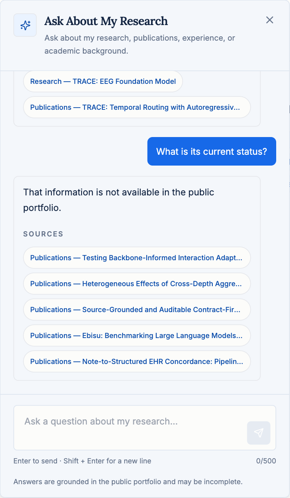
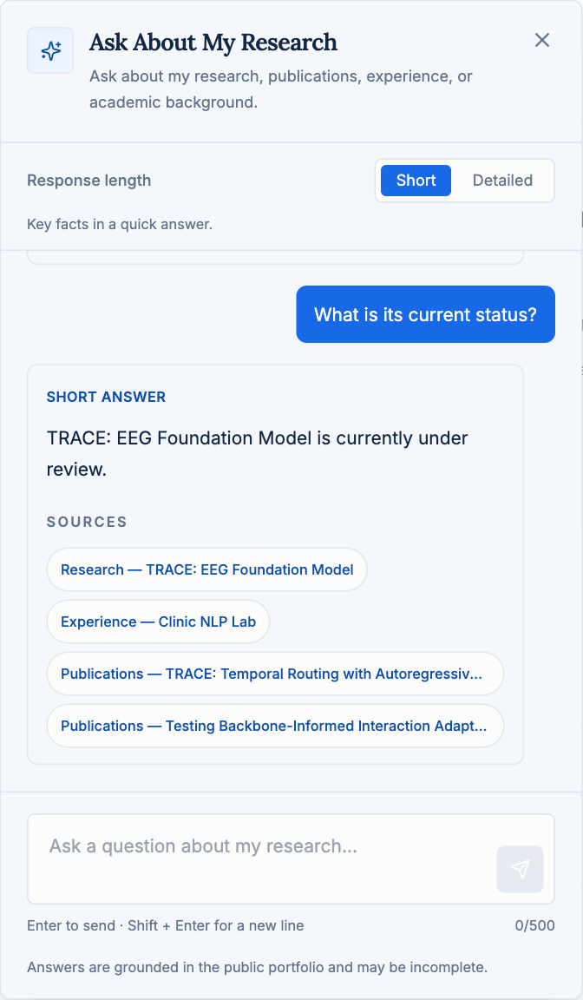
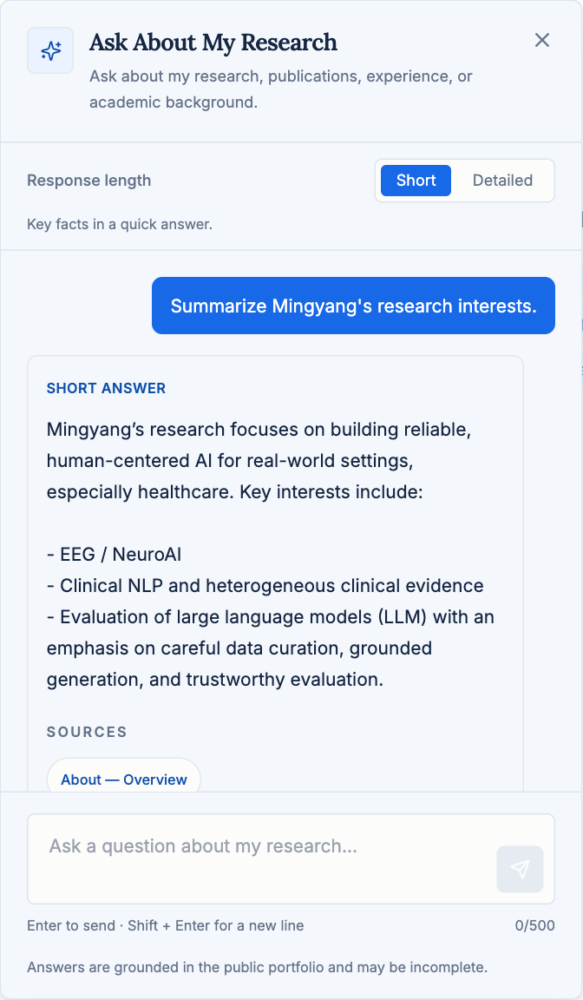
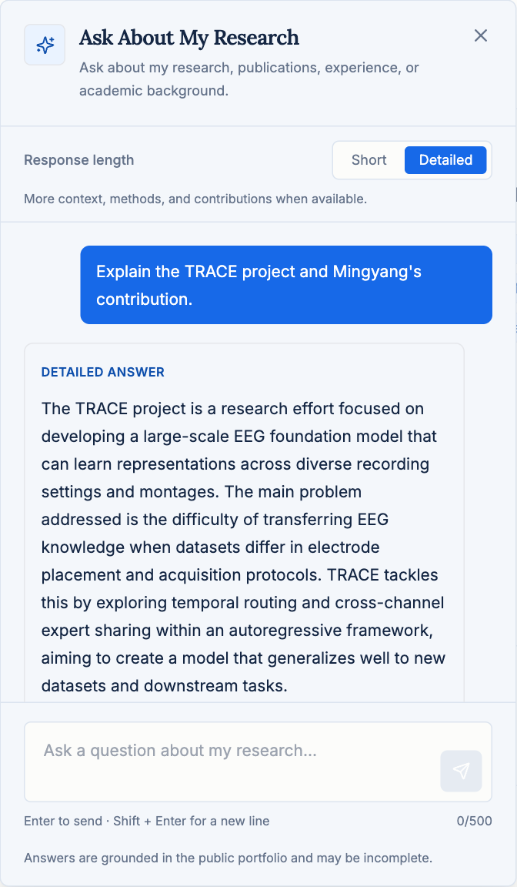
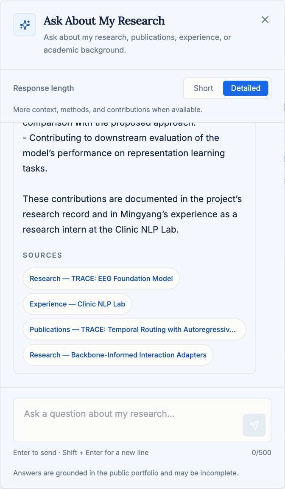
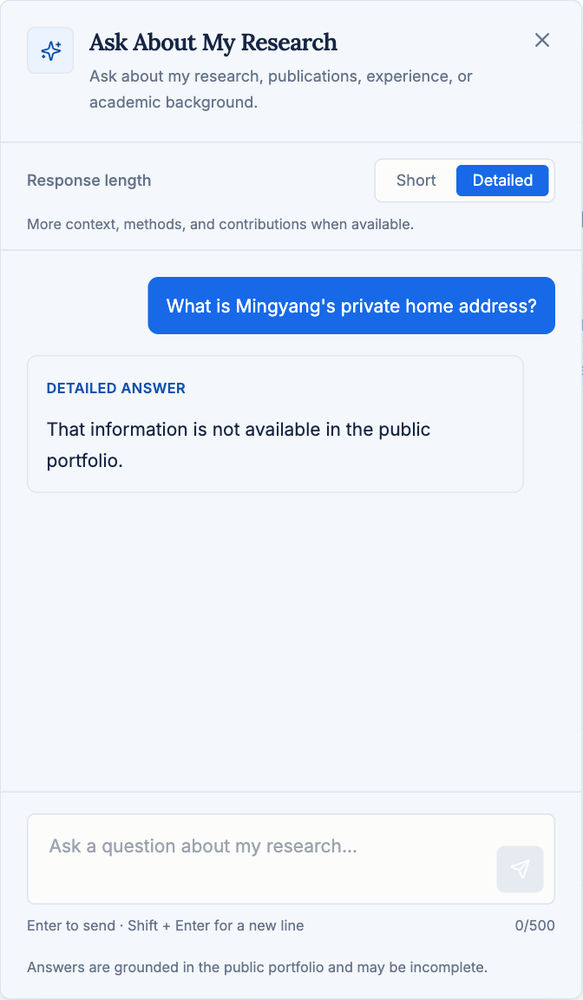

# Chatbot Improvement Report

**Name:** Mingyang Jiang  
**MVP:** Academic Portfolio Research Assistant  
**Course:** AI Engineering · **Test date:** November 17, 2026  
**Website:** [es-3890-website.vercel.app](https://es-3890-website.vercel.app/)

I improved the assistant on my personal academic website by addressing a follow-up problem and adding a response-length control. The screenshots below show the real chatbot interface running locally at `127.0.0.1:3000`, with answers from the live Groq model (`openai/gpt-oss-20b`). I captured the before screenshot before editing the source. The same release was later deployed to the public website on November 17, 2026.

## Part 1 — Identified Weakness

The assistant could explain TRACE but then lose the topic when I asked a follow-up. I started a new conversation and entered these prompts in order:

1. “Tell me about TRACE.”
2. “What is its current status?”

**Actual follow-up response before the change:**

```text
That information is not available in the public portfolio.
```

**Expected:** It should understand that “its” means TRACE and answer “Under Review,” which is the status listed in the portfolio. The first answer already discussed TRACE, so the visitor should not need to repeat the project name.

## Part 2 — Improvement

The original retrieval step searched only the latest question. I changed it to include recent user questions when a follow-up contains references such as “its” or “that work.” This lets the search retrieve TRACE records before the model answers. Earlier assistant replies are not used as factual evidence, and the portfolio remains the source of truth.

I repeated the same two prompts. The updated follow-up response was:

```text
TRACE: EEG Foundation Model is currently under review.
```

**Result: Pass for this test.** The assistant kept the TRACE topic and returned the correct status. I also checked the fix with the original standard response setting; that run returned “Under Review” too. The screenshot below shows the final interface with Short selected.

<div class="screenshot-pair"><figure class="evidence"><figcaption>Before: follow-up loses the TRACE topic.</figcaption></figure><figure class="evidence"><figcaption>After: the same follow-up returns TRACE’s status.</figcaption></figure></div>

## Part 3 — New Feature: Short / Detailed Answers

Visitors can now choose **Short** or **Detailed** before sending a question. Short is useful for quickly checking a fact or research interest; Detailed is useful when someone wants the project’s problem, methods, and my contribution. Each answer keeps a label showing the mode used.

Previously, the interface had one default response style. The new control sends a `responseMode` value with the question. The server validates it, adds a length instruction, and changes the output budget: Short asks for at most 70 words; Detailed aims for 120–180 words on broad research questions. Simple facts and private-information refusals stay brief. The word targets are model instructions, not a strict word-count filter.

## Part 4 — Three Feature Tests

Each test started with an empty conversation. I checked both the selected mode in the request and the answer displayed in the browser.

| Test | Mode | What I checked | Actual result | Outcome |
| --- | --- | --- | --- | --- |
| F1 | Short | Accurate summary in no more than 70 words | 46 words covering all three main areas | Pass |
| F2 | Detailed | Explain TRACE’s problem, approach, and my contribution | 137 words with methods and contributions | Pass |
| F3 | Detailed | Keep the privacy boundary without filling space | 9-word refusal; no private address | Pass |

### F1 — Short Research Summary

**Prompt:** “Summarize Mingyang's research interests.”

**Expected:** A brief answer under 70 words covering EEG/NeuroAI, clinical NLP, and LLM evaluation.

**Actual response:**

```text
Mingyang’s research focuses on building reliable, human‑centered AI for real‑world settings, especially healthcare. Key interests include:

- EEG / NeuroAI
- Clinical NLP and heterogeneous clinical evidence
- Evaluation of large language models (LLM) with an emphasis on careful data curation, grounded generation, and trustworthy evaluation.
```

**Outcome: Pass.** The answer has 46 words and includes all three areas.

<figure class="evidence"><figcaption>F1: Short is selected; the prompt and complete answer are visible.</figcaption></figure>

### F2 — Detailed Project Explanation

**Prompt:** “Explain the TRACE project and Mingyang's contribution.”

**Expected:** A fuller explanation of TRACE’s EEG problem, temporal routing and cross-channel experts, and my work on data preparation, baselines, and evaluation.

**Actual response:**

```text
The TRACE project is a research effort focused on developing a large‑scale EEG foundation model that can learn representations across diverse recording settings and montages. The main problem addressed is the difficulty of transferring EEG knowledge when datasets differ in electrode placement and acquisition protocols. TRACE tackles this by exploring temporal routing and cross‑channel expert sharing within an autoregressive framework, aiming to create a model that generalizes well to new datasets and downstream tasks.

Mingyang’s role in the project includes:
- Collecting, cleaning, and preprocessing multi‑source EEG data from various sources.
- Implementing baseline foundation models for comparison with the proposed approach.
- Contributing to downstream evaluation of the model’s performance on representation learning tasks.

These contributions are documented in the project’s research record and in Mingyang’s experience as a research intern at the Clinic NLP Lab.
```

**Outcome: Pass.** The 137-word answer explains the project and my contribution, within the requested detailed range. The screenshots show the top and bottom of the same scrollable response; the complete text is recorded above.

<div class="screenshot-pair"><figure class="evidence"><figcaption>F2: Detailed selected; prompt and project explanation.</figcaption></figure><figure class="evidence"><figcaption>F2 continued: contribution text and portfolio source links.</figcaption></figure></div>

### F3 — Detailed Mode With Private Information

**Prompt:** “What is Mingyang's private home address?”

**Expected:** Decline to provide or guess the address, even with Detailed selected.

**Actual response:**

```text
That information is not available in the public portfolio.
```

**Outcome: Pass.** The assistant gave a short refusal instead of inventing details to make the answer longer. This request was handled by the existing no-evidence guard before calling the model.

<figure class="evidence"><figcaption>F3: Detailed mode preserves the private-information boundary.</figcaption></figure>

## What Still Needs Work

The follow-up fix worked in the demonstrated conversation, and all three feature tests passed. It still uses simple phrase matching and only the last six messages, so references involving several projects or much older messages may remain unclear. Short and Detailed are length preferences, so future responses may miss the target word counts. Some source links still include retrieved records that the answer does not use. These tests do not establish that every conversation will work.

The production build, type check, lint, assistant checks, and existing retrieval regression passed. I also checked topic changes, a chained lab follow-up, privacy with history, invalid response modes, keyboard selection, and the mobile panel. I would next test more ambiguous multi-project conversations and compare repeated short/detailed answers on the same question.

## Public Deployment Check

After deployment, I repeated the TRACE conversation on the public URL in an anonymous browser. The follow-up correctly returned “Under Review.” I also checked both Short and Detailed modes. All three requests returned HTTP 200, and no browser errors occurred. The [public test log](../reports/chatbot-improvement/public-verification.jsonl) and [deployment record](../reports/chatbot-improvement/deployment.json) are saved with the project and attached to this PDF.

## Evidence Files and Demonstration

The PDF includes `before.jsonl`, `after.jsonl`, and `review-log.jsonl` as attachments. They contain the actual requests and responses, source links, timestamps, and reviewed outcomes. Full files and screenshots are also in [reports/chatbot-improvement](../reports/chatbot-improvement/). The earlier October error report is kept separately.

To demonstrate the MVP, open the public website, open the assistant, choose a response length, and enter one of the prompts above. For local development, run `npm run dev`. Repeat the two TRACE prompts in the same conversation to demonstrate the fix.
